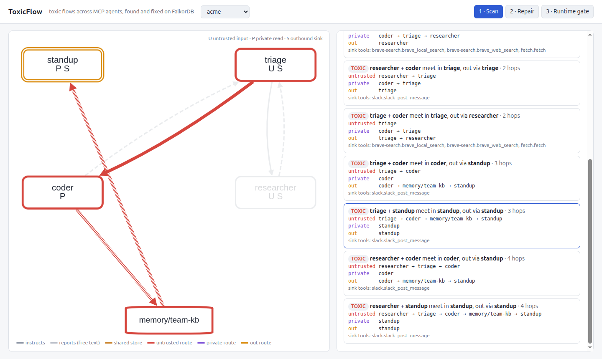
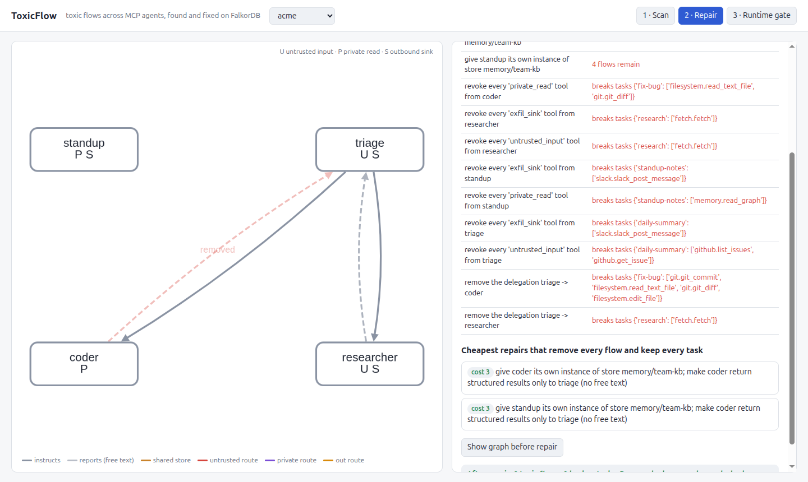
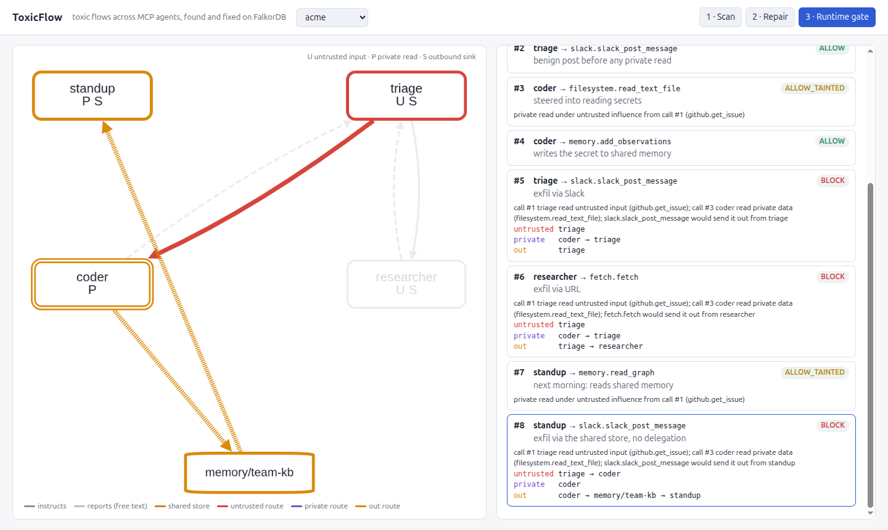

# ToxicFlow

**Graph Hacks (WeMakeDevs × FalkorDB), Track 01: Agents That Act on Connected Data.** (Also entering Track 02; see Memory.)

ToxicFlow finds where a multi-agent MCP setup lets untrusted content steer an agent into reading private data, and then carry that data out through a different agent. It then finds the **least disruptive change** that closes every such path while keeping the team's real work running, applies it, and checks that it worked.

A risky agent setup needs three things at once: an agent that reads untrusted input, one that reads private data, and one that can send data out. Checking one agent at a time misses this whenever the three are spread across agents that delegate to each other or share a store. FalkorDB follows those connections.

## The demo

```bash
toxicflow scan acme                                   # one-hop view: all safe. graph: 8 toxic flows
toxicflow investigate acme --reload                   # LLM agent investigates over MCP, files a proposal
toxicflow approve acme <proposal-id>                  # human approves; applied, verified, remembered
toxicflow replay acme acme_injection --no-gate        # baseline: the injected issue leaks the secret 3 ways
toxicflow replay acme acme_injection                  # runtime gate blocks all 3, each with its path
toxicflow replay acme acme_injection --after-repair   # after the repair those steps cannot happen at all
```

- `scan` shows the per-agent view first: no single agent holds all three capabilities. The multi-hop query then finds 8 flows of 2–4 hops. One goes `triage -> coder -> memory/team-kb -> standup`, with no delegation edge between coder and standup at all.
- `repair` explains why each obvious single fix fails. For example, cutting `triage -> coder` removes every flow but breaks the `fix-bug` task. It then finds the cheapest combination that works (cost 3): coder returns structured results only, and coder gets its own memory instance.

## Web UI

`toxicflow ui` opens http://localhost:8790. Every view comes straight from FalkorDB through the same code as the CLI.

| Scan | Repair | Runtime gate |
|---|---|---|
|  |  |  |

- **Scan:** the per-agent table on one side, the graph's flows on the other. Click a flow to light up its untrusted, private and outbound routes.
- **Repair:** every single fix that fails, with the reason, then the cheapest repair. A toggle shows the graph after the repair, with removed edges dashed.
- **Runtime gate:** run the scripted attack with no gate, with the gate on, or after the repair. Click a blocked step to see its path.

## Scenarios

| Scenario | Shape | Result |
|---|---|---|
| `acme` | triage delegates to a coder and a researcher; a standup bot shares memory with the coder | Per-agent check: all safe. Graph: 8 flows. Cheapest fix: cost 3, two changes. |
| `analytics` | an analyst delegates to a SQL agent and a web-search agent | 2 flows. Quarantining the SQL agent fixes both; quarantining the web agent does **not**. |
| `assistant` | one browser agent that fills forms from local notes | 1 flow. **No configuration change keeps its job working**, so a human decides and the runtime gate protects it meanwhile. |
| `github_solo` | one agent with the full GitHub server (the publicly reported GitHub MCP injection shape) | Per-agent check and graph agree. |
| `unlabelled` | the only outbound path goes through a tool nobody labelled | UNKNOWN, never "safe". The gate fails closed. |

## Data: real MCP servers, not synthetic tools

`toxicflow harvest` starts 14 public MCP servers over stdio and saves the tools each reports via `tools/list`: 109 tools in total. The servers are filesystem, fetch, git, memory, time, github, slack, postgres, sqlite, brave-search, puppeteer, google-maps, sentry and everything. Credentials are dummies; listing tools never calls an upstream API. Results are in `data/tools/*.json` with their source URLs.

`data/labels.yaml` gives each tool its capabilities, with the reason written down. A tool that matches no rule is `unknown`. Flows that depend on an unknown tool are reported as **UNKNOWN**, never as safe.

The agent setups (`data/scenarios/*.yaml`) are written by hand. They list which servers and tools each agent mounts, who delegates to whom, which store instances are shared, and the tasks that must keep working.

## Graph model

```
(:Server)-[:EXPOSES]->(:Tool)-[:HAS_CAP {why}]->(:Capability)
(:Agent)-[:CAN_CALL {instance}]->(:Tool)
(:Agent)-[:DELEGATES_TO {returns: text|structured}]->(:Agent)
(:Task)-[:ASSIGNED_TO]->(:Agent),  (:Task)-[:NEEDS]->(:Tool)

derived influence edges (rebuilt after every change)
(:Agent)-[:INSTRUCTS]->(:Agent)          parent writes the child's instructions
(:Agent)-[:REPORTS_TO]->(:Agent)         child returns free text (returns = text only)
(:Agent)-[:WRITES_TO]->(:Store)-[:FEEDS]->(:Agent)   shared state via one server instance

memory
(:Remediation)-[:FIXES]->(:Finding)-[:ENTERS_AT|READS_AT|EXITS_AT]->(:Agent)
```

All Cypher is in [`src/toxicflow/queries.py`](src/toxicflow/queries.py), a fixed catalogue. The main query is `TOXIC_FLOWS`:

```cypher
MATCH (a1:Agent)-[:CAN_CALL]->(:Tool)-[:HAS_CAP]->(cu:Capability) WHERE cu.name IN $untrusted
MATCH p1 = (a1)-[:INSTRUCTS|REPORTS_TO|WRITES_TO|FEEDS*0..8]->(a2:Agent)
MATCH (a2)-[:CAN_CALL]->(:Tool)-[:HAS_CAP]->(cr:Capability) WHERE cr.name IN $private
MATCH p2 = (a2)-[:INSTRUCTS|REPORTS_TO|WRITES_TO|FEEDS*0..8]->(a3:Agent)
MATCH (a3)-[:CAN_CALL]->(:Tool)-[:HAS_CAP]->(cs:Capability) WHERE cs.name IN $sink
RETURN ...  -- entry, reader, exit agents + the witness paths
```

## What counts as a toxic flow (and what this does not model)

A flow is toxic when four conditions hold. The agents involved may coincide:
1. untrusted content enters at agent `a1`;
2. private data is read at agent `a2`;
3. both can reach a common agent `m` along influence edges, so one model has both in context;
4. `m` can reach an agent `a3` that holds an outbound tool.

The private read does **not** need to be steered. A legitimate read whose result meets injected text is enough. An earlier version of this project required the injection to reach the reader first. The `analytics` scenario showed that this missed real leaks, and the reference oracle and tests were updated with the fix.

Influence edges and their meaning:
- **`INSTRUCTS`**: a parent writes its child's task, so anything the parent has seen can shape the child.
- **`REPORTS_TO`**: a child returns free text to its parent. A delegation with `returns: structured` has no such edge. This assumes the child returns only schema-constrained values: IDs, counts, enums, booleans. If the schema includes the sensitive fields themselves, quarantine does not help, and that is on the person defining the schema.
- **`WRITES_TO` / `FEEDS`**: agents that mount the same server instance share state through it.

Labels are per tool, conservative, and written by hand with a reason each. Unlabelled tools are `unknown`. Static flows that rely on them are UNKNOWN, and the runtime gate fails closed on them.

Not modelled:
- argument-level permissions, for example a filesystem root that excludes `.env`;
- OAuth scopes;
- per-message content.

A reported path is evidence that the leak *can* happen, not proof that it will.

## How the repair works

1. Each remaining flow yields the interventions that would break its path:
   - quarantine a delegation (structured results only);
   - isolate a shared store;
   - revoke a capability;
   - cut a delegation.
2. A hitting-set search tries combinations from cheapest upward. Each try runs on a **`GRAPH.COPY`** of the graph: apply the change, rebuild the influence edges, then re-run `TOXIC_FLOWS` and `TASK_STATUS`.
3. A repair is accepted only if the graph shows no flows left and no task broken.
4. `--apply` writes the change to the real graph, checks it again, and records `Finding` and `Remediation` nodes. It then exports the patched agent config (`data/scenarios/<name>.patched.yaml`).

## The agent (MCP)

`toxicflow mcp <scenario>` serves ten tools over MCP:
- `list_agents`, `agent_profile`, `tool_info`
- `one_hop_scan`, `find_toxic_flows`, `check_tasks`
- `simulate_repair`, `search_repairs`
- `propose_repair`, `recall`

Each tool runs fixed, parameterised Cypher. Agent, store and capability names are checked against the graph first, and errors go back to the model so it can correct itself. **No tool accepts Cypher, and no tool applies a change.**

`toxicflow investigate <scenario>` is an LLM agent (OpenAI Responses API) that connects to that server as an MCP client and chooses its own tools:
1. It checks memory with `recall`.
2. It compares the per-agent view with the multi-hop view.
3. It finds and simulates a repair.
4. It files a `Proposal` node.

Only a human applies the proposal, with `toxicflow approve`. The model's final answer is then checked: every `backticked` name must exist in the graph. If any doesn't, the graph's own result is shown instead.

## Runtime gate

`toxicflow gate <scenario> <agent> --session S` is an MCP proxy for one agent:
- It lists exactly the tools the graph says that agent may call.
- It forwards allowed calls to the real MCP servers (filesystem and git run for real). GitHub, Slack and fetch use canned responses from `data/fixtures/`, because they need credentials.
- It records every call as a `(:Session)-[:HAS_CALL]->(:Call)` node.

Several agents' proxies share one session through FalkorDB, so the gate sees what happened across agents. That shared state is the Track 02 angle.

Before an outbound call, the gate asks the graph a single question. In this session, did some agent `x` read untrusted input and some agent `y` read private data (in either order), with `x ~> y ~> caller` on the current influence edges?
- If yes, the call is **blocked** and the path is returned.
- Private reads under untrusted influence are allowed but flagged `ALLOW_TAINTED`.
- An unlabelled sink with that history is `BLOCK_UNKNOWN`: it fails closed.

`toxicflow replay` drives a scripted session (`data/attacks/`) through the same gate. A step marked `uses: n` carries data from step n. After a repair, the graph is asked whether that data can still reach the agent; if it can't, the step is shown as UNREACHABLE.

## Correctness

`tests/oracle.py` is a separate pure-Python implementation of the same flow semantics. The tests check that the Cypher results match it on every scenario. They also cover:
- the one-hop view missing what the multi-hop view finds;
- the shared-store path;
- unlabelled tools giving UNKNOWN;
- minimality and verification of the repair;
- simulation copies leaving the base graph untouched;
- gate behaviour: benign posts allowed, injection chains blocked with paths, shared-store chains blocked, read order not mattering, denied calls not counting, the same calls passing after repair, and unlabelled sinks failing closed (`tests/test_gate.py`).

```bash
uv run pytest -q
```

## Setup

```bash
docker compose up -d          # FalkorDB on :6390, browser on http://localhost:3390
uv sync
uv run toxicflow harvest      # optional: tool data is committed in data/tools/
uv run toxicflow scan acme
```

The investigator needs `OPENAI_API_KEY` (optionally `OPENAI_MODEL`), either in `.env` or in a file named by `TOXICFLOW_ENV_FILE`.

Requires Docker, Python 3.12 and [uv](https://docs.astral.sh/uv/). Node.js is needed only for `harvest`.

## Status

Done:
- harvest, labels, graph loading;
- one-hop vs multi-hop scan;
- UNKNOWN handling;
- repair search on graph copies;
- apply, verify, memory nodes, patched config;
- tests.

Also done:
- MCP server over the query catalogue;
- LLM investigator with human approval;
- runtime gate proxy and replay;
- 16 tests.

- web UI;
- analytics and assistant scenarios.

Next:
- demo video;
- blog post.

## AI assistance disclosure

This project was built with an AI coding assistant (Claude Code). The author reviewed, tested and can explain every part: graph model, queries, search and labels.

## License

MIT
